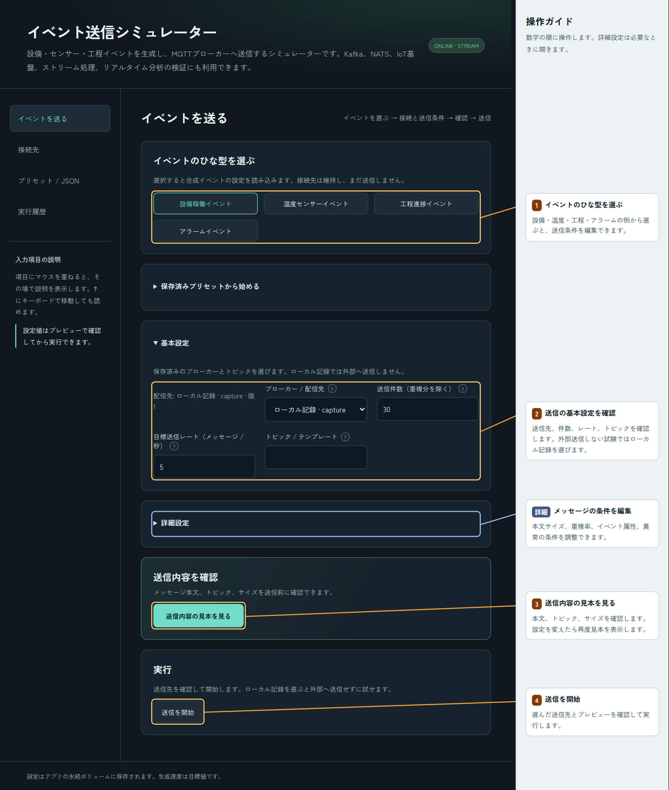

# ストリームデータ送信ツール

[プリセット一覧](presets/README.md) · [Dokploy配備手順](docs/dokploy.md) · [コード読解ガイド](CODE_GUIDE.ja.md)

任意のイベントをMQTTだけでなくKafka、AMQP、NATS、WebSocket、HTTPへ送信できます。すべての方式と配送確認の意味を、選択欄とホバーヘルプで説明します。

| 方式 | 用途と配送確認 |
| --- | --- |
| MQTT | 設備向けの軽量Pub/Sub。QoS 1/2はブローカーACKまで。受信処理の完了とは別 |
| Kafka | 再生可能なイベントログ。record_keyをキーにし、acks=allとidempotenceを有効化 |
| AMQP 0-9-1 | RabbitMQ等のキュー配送。persistentメッセージとmandatory / publisher confirms。vhost / exchange / routing keyを指定 |
| NATS | 軽量なsubject配信。Coreはサーバーへのflushまで。JetStreamは既存streamへの保存ACKまで |
| WebSocket | 常時接続のJSONテキストフレーム。ACKなし / OK等のテキスト / accepted:1のJSONから選択 |
| HTTP | 受信APIへPOST/PUT/PATCH。単件・配列・NDJSON。Basic/Bearer/APIキー。2xx受付と任意のaccepted/failed/errorsを確認 |
| キャプチャ | 外部送信せず、永続SQLite outboxへ生成JSONを保存。データ条件を確認する方式で、pendingになるのが想定動作 |

送信前に本文・配送先・接続先の識別情報を永続outboxへ記録し、配送確認後にdeliveredとします。再送は同じ接続先・方式のpendingだけが対象です。接続先を変更して別のサーバーへ自動転送しません。応答消失時等は重複し得るため、受信側でもrecord_keyで重複排除してください。Core NATSやACKなしWebSocketでは永続保存を確認できない点に注意してください。

MQTTのTLS・バージョン・QoS・retain・Keep Alive、HTTPの認証・追加ヘッダー、KafkaのSASL/TLS、AMQPのvhost/キュー、NATSのトークン/credentials/JetStream、WebSocketのサブプロトコル等をプロファイルで設定できます。実行ごとにJSON構造、配送先テンプレート、メタデータ有無を変更できます。

同梱Mosquittoは検証用の独立したブローカーです。他のブローカーを接続先に設定することもできます。Kafka/AMQP/NATSのサーバーをこのアプリが自動構築するわけではありません。

# Data Source Studio 共通仕様

3つのツールはそれぞれ独立したリポジトリ・アプリ・永続ボリュームです。設定は業種に依存しません。v2では接続プロファイル、任意のデータ項目、生成ルール、実行条件を画面で編集できます。

## 操作ガイド

[ひな型の選び方・詳細設定の画面・自分のひな型の作り方](docs/preset-guide.md)

[](docs/images/operation-guide.png)

イベントのひな型を選び、「基本設定」で送信先・件数を確認して「送信内容の見本を見る」を押します。本文サイズ、重複率、異常の割合などを変えるときは「詳細設定」を開きます。

1. 「イベントを送る」で設備稼働、温度センサー、工程進捗、アラームのいずれかを選びます。合成イベント30件の条件を読み込みます。配信は「送信を開始」から行います。
2. 保存済みブローカー、トピック、送信件数・レートを確認します。接続先の追加・疎通確認は「接続先」で行います。外部へ送信せずに実行を試す場合は、ローカル記録を選びます。
3. 「送信内容の見本を見る」で送信本文、トピック、UTF-8バイト数と重複予定を確認します。プレビューはブローカーへ接続しません。異常位置を含む最大12件のサンプルで、すべてのメッセージや下流での受信を保証するものではありません。
4. 「送信を開始」は現在の配信先・条件をプレビューしたうえで明示した場合だけ実行します。同じ接続先IDでも保存した版が変更されると送信しません。表示された接続先を確認し、再度プレビューしてください。受付後は「実行履歴」で進捗・停止・再編集ができます。詳細設定は初期状態では閉じており、イベント属性や障害シナリオを必要なときに編集できます。
5. 「保存済みプリセットから始める」には既存のJSONプリセットがあります。「この設定を保存…」から別名保存でき、JSONの読み込み・書き出しにも対応します。

MQTTとローカル記録では、本文を切り詰めずUTF-8 JSONの末尾に空白を追加してサイズの下限を試せます。重複率は元のメッセージそれぞれに同じトピック・本文の1回追加送信を割り当てる確率です。100%では送信数が2倍になります。受信側の重複排除用の本文中の識別子は同一で、送信側のoutbox配送枠だけを分けます。件数入力は元のメッセージ数で、目標送信レートは重複を含むバッチ単位の目安です。既存プリセットでこの2項目を指定しない場合は無調整です。

イベント生成・本文整形は配信先の接続処理から分離しています。MQTT以外の有効な接続方式と既存のプリセット形式は維持します。

プリセットには接続IDだけを保存します。パスワード、接続文字列、トークン、SSH秘密鍵等は接続プロファイルへ暗号化保存し、読み戻しと書き出しには含めません。空欄は同じ接続先の既存値を維持し、接続先や認証方式が変わると以前の資格情報を引き継ぎません。明示的な削除はclear_secretsで指定します。

証明書、Wallet、known_hosts、DSN設定等は接続先画面からconnection-filesへ配置できます。ファイル自体は権限600で保存します。これらのファイルと設定暗号鍵を含む永続ボリュームのバックアップは保護してください。公開リポジトリには保存しません。

## 自由なデータ定義

型はstring / integer / number / decimal / boolean / datetime / json。生成器はrecord_id、uuid、sequence、integer、uniform、normal、choice、boolean、constant、template、timestamp、reference、sum、difference、product、ratio。

日時はタイムゾーン付きISO形式を指定し、UTCへ変換します。decimalはJSONでは正確な文字列、SQLではNUMERICへ変換します。テンプレートは`DEV-{entity_no:05d}`のような先行項目・共有値・sequence・record_idの参照に対応し、任意Pythonは実行しません。JSON構造テンプレートは`$row.項目` / `$parameters.名前` / `$meta.record_key`等を参照し、入れ子のオブジェクトと配列を定義できます。

項目名・SQL識別子は英字/下線で始まる英数字/下線、63文字まで。主キーはNULL不可。1レコードのJSONは1MiBまで、1実行は1億レコードまでです。拡張契約は`contracts/preset.schema.json` / `contracts/connection.schema.json`にあります。

## 大量生成

48種類の編集可能なJSONプリセットを同梱。通常24種類と、MES/ERP等の異常24種類を用意。少量・大量生成、分布・派生値・書式に加え、固着・ドリフト・時刻ずれ・数量不整合・処理障害等を設定できます。件数、開始位置、乱数seed、目標速度、バッチ件数、時間・容量上限、初期待機、ゆらぎ、バースト件数・待機を変更できます。目標速度0は速度制限なし。実速度は生成内容・接続先・ディスクに依存します。

実行は各ツール1件ずつ。全件をメモリには保持せず、行サイズに合わせてバッチを縮小します。ホストのメモリ余力・ディスク余力を監視し、閾値に達した場合は停止します。設定と履歴は永続化し、プロセス再起動で中断された実行はinterruptedになります。実行開始時に接続プロファイルの版を固定します。

## ローカル起動

Python 3.12とuv、Docker Composeを使用します。

```sh
uv sync --frozen
uv run python scripts/init_local.py --private-dir ./private --data-dir ./data --env-file .env
docker compose up -d --build
```

`.env`でポートと必要なマウント元を設定します。管理画面・操作API・メトリクスはログイン不要です。`uv run uvicorn app:app`で直接起動する場合はDATA_DIRを設定してください。

`DATA_DIR=/data`に設定DB、暗号鍵、実行履歴を保存。接続用ファイルの配置先はCONNECTION_FILES_DIR（既定DATA_DIR/connection-files）です。秘密鍵と設定DBを一緒に公開しないでください。

## APIと検証

ログイン不要のAPI: `/api/info`、`/api/schemas`、`/api/connections`、`/api/presets`、`/api/preview`、`/api/runs`。プロファイル保存後の`/api/connections/{id}/test`は保存済み設定を検証します。`/healthz`と`/metrics`も認証不要です。UIとAPIの変更操作は同一オリジンとJSONを要求します。

```sh
uv run pytest -q
uvx ruff check .
```

v0.1の固定MES/ERP設定JSONはv2の任意項目定義へ置き換えました。過去の実行履歴・SQLテーブル・出力ファイル・旧outboxは保持します。旧outboxの未配送データは新しい接続先へ自動転送しません。

実接続のスモークテストは STREAM_TEST_PROFILES_FILE に非公開の接続プロファイル配列JSONを指定して実行できます。検証用の配送先を用意し、資格情報ファイルはGitへ追加しないでください。

プリセットの再生成は `uv run python scripts/build_presets.py --kind stream`。新規プリセットだけを初回起動時に登録し、保存済みプリセットを更新で上書きしません。

## 異常シナリオと説明

プリセット選択時には、想定状況・発生データとタイミング・確認事項・実行条件を表示します。既存の通常プリセットにも説明を用意しています。異常ルールは正常行の生成後に適用し、対象の項目、適用開始/終了位置、頻度、確率、比較条件を変更できます。ルールは上から順に適用します。

データの異常があるだけでジョブが失敗するとは限りません。制約のないDBやメッセージブローカーは、不整合な業務データも受け付けるため、取り込み側の品質チェックで検知する試験です。型や必須項目の不正、処理障害のプリセットでは意図的にfailedで終了するケースもあります。

処理障害はこの実行だけの例外・待機で再現し、外部サーバーを停止したりネットワーク設定を変更しません。SQLはCOMMIT前に障害を入れるとそのバッチをrollback、ファイルは完了前に止めるとready.jsonなし、ストリームはACK後の異常でpendingを残し、同じrecord_keyの重複再送を検証できます。ストリームの自動再試行は実行条件で上書き可能です。

他アプリとの組み合わせや、SECS/GEMなどの検討中の方式は[データソースの構成と拡張候補](docs/source-roadmap.md)を参照してください。

## 外部監視用の管理ラベル

Composeの管理ラベルは既定で `factory.guard.managed=true` です。外部監視側との合意が必要な場合は、非公開の配備設定で `FACTORY_GUARD_LABEL_PREFIX` を指定できます。例えば説明用の値 `synthetic-guard` を指定すると、`synthetic-guard.guard.managed=true` になります。

既存の外部監視との互換性は未確認です。変更前に監視側が照合するラベル名と影響を確認してください。この設定は既存コンテナや監視設定を自動移行せず、デプロイも行いません。

## Dokployでの配置とプロキシ

[Dokploy配置手順](docs/dokploy.md)に、準備・環境変数・永続化・非公開アクセス・確認・更新と、ビルド/実行時のプロキシの違いをまとめています。
