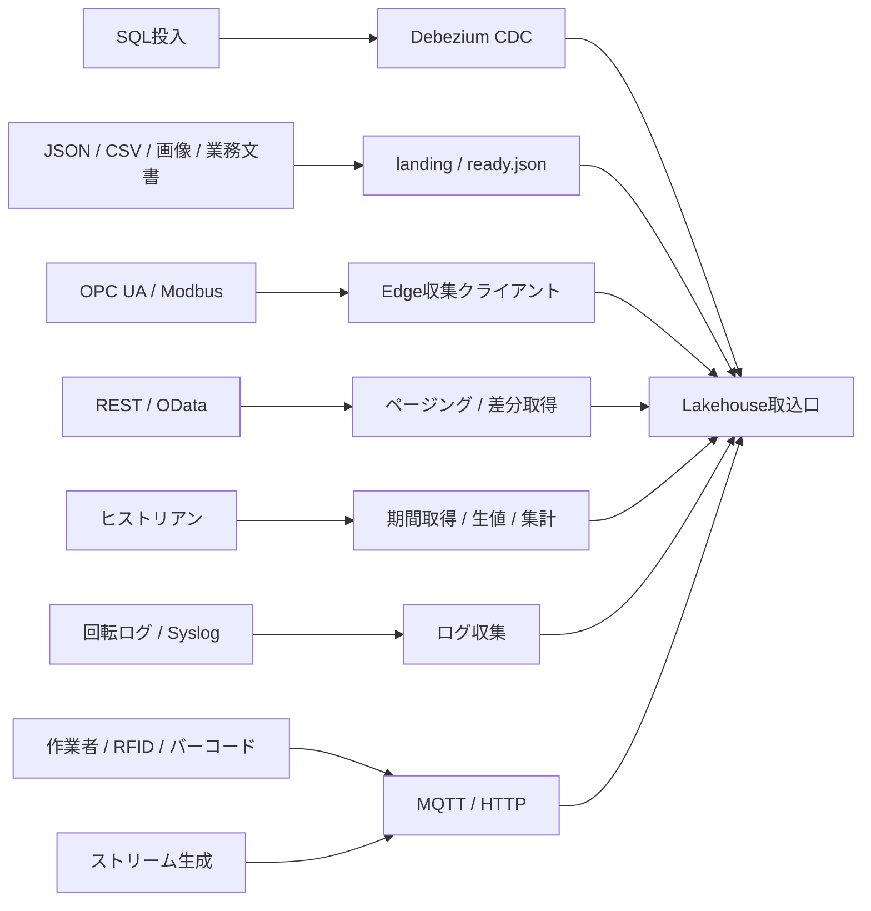

# データソース構成例

以下は説明用の構成例です。`<...>` は利用環境で決める値のプレースホルダーであり、そのまま実行する設定ではありません。実際の接続先やポートは非公開の配備設定で指定してください。

| 種類 | リポジトリ | 画面の既定ポート | 収集方法 |
| --- | --- | --- | --- |
| SQL | [factory-sql-data-loader](https://github.com/hiromura16/factory-sql-data-loader) | 3560 | DBをCDC/クエリで取得 |
| ファイル | [factory-file-generator](https://github.com/hiromura16/factory-file-generator) | 3561 | landingのready.jsonを起点に取得 |
| ストリーム | [factory-stream-simulator](https://github.com/hiromura16/factory-stream-simulator) | 3562 | MQTT/Kafka/HTTP等 |
| 設備 | [factory-equipment-simulator](https://github.com/hiromura16/factory-equipment-simulator) | 3640 | OPC UA `<OPC_UA_PORT>` / Modbus TCP `<MODBUS_TCP_PORT>` |
| 業務API | [factory-api-simulator](https://github.com/hiromura16/factory-api-simulator) | 3641 | REST / ODataサブセット |
| ヒストリアン | [factory-historian-simulator](https://github.com/hiromura16/factory-historian-simulator) | 3642 | 履歴REST / 期間指定 / 集計 |
| ログ | [factory-log-simulator](https://github.com/hiromura16/factory-log-simulator) | 3643 | 回転ファイル / Syslog UDP・TCP・TLS |
| 識別 | [factory-identification-simulator](https://github.com/hiromura16/factory-identification-simulator) | 3644 | RFID・作業者イベント / MQTT・HTTP |

各アプリは独立したGitリポジトリ・設定・永続データで稼働します。構成例ではホスト名を `<GENERATOR_HOST>`、LAN接続先を `<LAN_BIND_ADDRESS>`、プライベートなオーバーレイネットワークの接続先を `<OVERLAY_BIND_ADDRESS>` と表します。実際に公開するインターフェースとポートは利用環境に合わせて限定してください。これらの例示名はComposeの環境変数名を定義するものではありません。ネットワークの共有が必要な場合は、配備先の構成として別途設計します。公開Compose単体は通常の独立ネットワークで起動します。資格情報はホストの非公開設定へ保存します。

収集クライアント・Edge GatewayとCloudflare側の取り込みは別コンポーネントです。この追加はソースの模擬までを実装し、Cloudflareへの本番取り込みやAI/BIを自動配備していません。

横断試験にはequipment_id / lot_id / work_order_id等の業務キーと、event_time / 受信時刻 / event_idを分けて設定してください。各アプリの既定プリセットが全て同じ業務トランザクションに自動連動するわけではありません。共通パラメーター・同じseed・同じキー規則で揃え、異常の正解ラベルは別の検証結果に保持するのが適しています。
