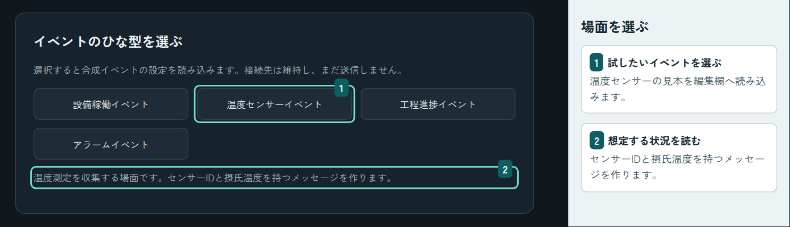
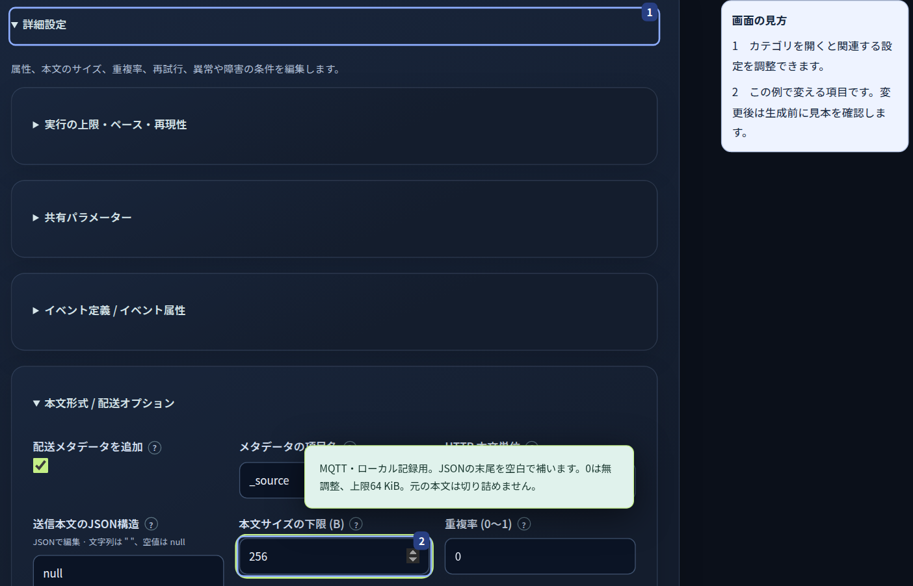
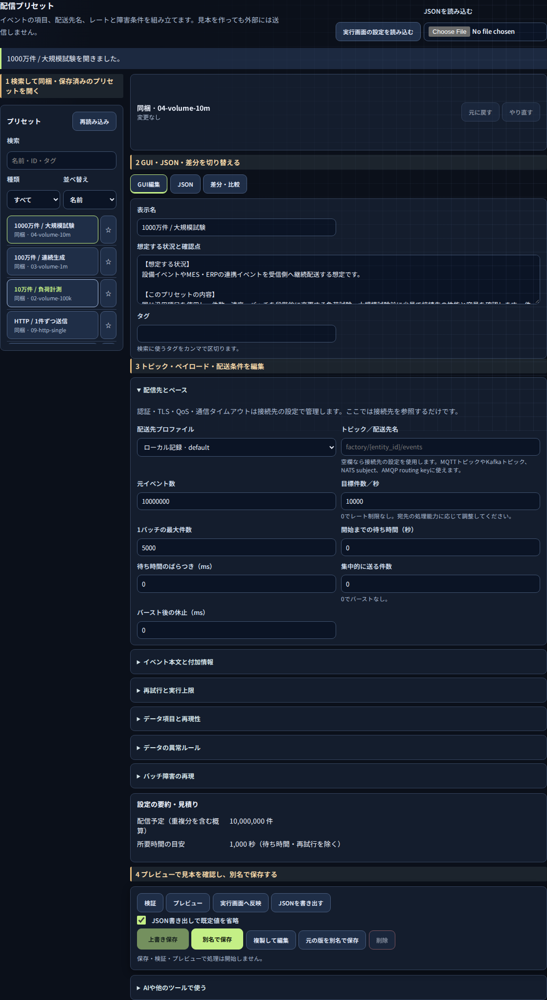
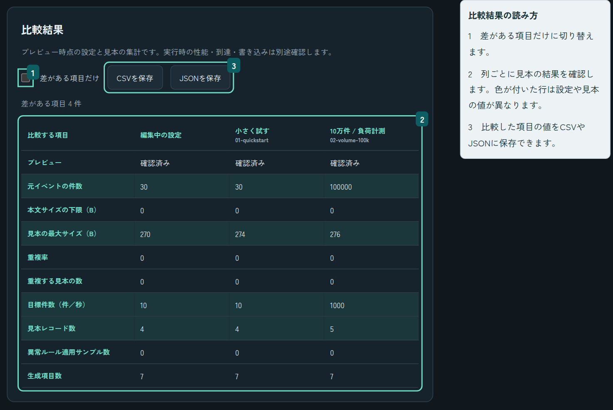

# ストリーム送信のひな型と詳細設定

ひな型（プリセット）は、生成するデータの項目・件数・書式や、再現したい異常をまとめた設定です。試したい状況に近いひな型を読み込み、見本を確認してから必要な設定を変えます。公開、書き込み、送信を始めるときは、画面の実行ボタンを使います。

## 選び方

最初に正常な少量のひな型を試します。その後は設定を一つずつ変更すると結果を比較できます。

| 確認したいこと | 選ぶひな型 | 最初に見る結果 |
| --- | --- | --- |
| ローカルまたは試験ブローカーで少量の受信確認 | 小さく試す（`01-quickstart`） | イベント本文と送信先を見本で確認し、イベントIDを受信側と突き合わせます。 |
| 受信側が入れ子の本文を読めるか調べる | 入れ子JSON / 測定値の配列（`06-nested-telemetry`） | 見本の測定値の入れ子を読み出し側の期待と照合します。 |
| ACK喪失に備えた重複処理の確認 | 異常 / 配送 ACK消失 / 重複再送（`46-stream-ack-loss`） | 試験専用の宛先で送信後、未確定状態と同じIDの扱いを確認します。 |

[付属のひな型一覧](../presets/README.md)のブラウザー版では、名前・ID・用途で検索できます。

## 読み込み・見本・保存・実行

- 読み込むと編集欄を置き換えます。編集中の内容は「プリセットを編集」で保存したり別の条件と比較したりできます。
- 見本で確認できるのは一部の値と形です。実行すると対象へ出力・公開します。
- 保存したひな型は次回から選べます。接続先や認証は使用する環境で選びます。

## 読み込みから見本まで

**温度センサーイベント** を例にします。

受信側が温度センサーのイベントをトピックで振り分け、重複排除できるかを調べる場面です。

「イベントのひな型を選ぶ」で「温度センサーイベント」を押します。保存済みのひな型を使う場合は「保存済みプリセットから始める」を開きます。

[](images/preset-scenario.png)

イベントのひな型を選ぶと、その下に模擬する状況が表示されます。保存済みのひな型は「どんな状況のひな型か」と「生成内容・確認すること・実行前の条件」で用途を確認できます。

設備の状態と計測値なら「設備稼働イベント」、工程の進捗率なら「工程進捗イベント」、警告と重大警報なら「アラームイベント」を選びます。

全ひな型の用途は[プリセット一覧](../presets/README.md)を参照してください。

## 詳細設定を変更して見本を見る

基本設定で送信先にローカル記録を選び、件数を3にします。「詳細設定 → 本文形式 / 配送オプション」で「本文サイズの下限 (B)」を256、「重複率 (0〜1)」を1にします。

[](images/advanced-settings.png)

| 設定 | 変えられること |
| --- | --- |
| 本文サイズの下限 (B) | MQTTとローカル記録では必要に応じてJSON末尾に空白を足して指定したバイト数以上にします。 |
| 重複率 (0〜1) | 0は追加なし、1は全件を1回ずつ追加します。 |
| イベント定義 / イベント属性 | 項目名、型、生成ルールを選びます。本文の構造は「送信本文のJSON構造」で設定できます。 |

**見本での確認**　「送信内容の見本を見る」で temperature_c を含む本文が256バイト以上になり、重複予定が表示されることを確認します。重複率1は元の1件につき1回を追加する設定です。

## プリセットを開く・編集する

メニューの「プリセットを編集」を開きます。実行画面で選択中のひな型を編集する場合は、「ひな型を読み込む」の隣にある「プリセットを編集」を押します。実行画面で値を変えたあと、その値から作りたい場合は、エディター上部の「実行画面の設定を読み込む」を使います。

[](images/preset-editor.png)

画面の番号に沿って操作します。

1. **検索して開く。** 名前、ID、用途、タグで検索し、対象の名前を押します。「同梱」はアプリに付属するひな型、「保存済み」は利用者が保存したひな型です。☆でお気に入りに追加でき、「最近開いた順」でも探せます。
2. **表示を切り替える。** 「GUI編集」「JSON」「差分・比較」から選びます。JSONは「整形」で読みやすくし、「GUIに反映」で戻ります。構文エラーがある場合は内容を直してから切り替えます。
3. **このアプリの設定を編集する。** トピック、イベント本文、配送ペースや再試行の条件を変更します。 表示名、想定する状況、タグも入力できます。行形式の設定は「追加」「複製」「上へ」「下へ」で組み替えられます。
4. **検証して見本を確認する。** 「検証」で型と設定の組み合わせを確認し、エラーの項目名から該当欄を探します。「プレビュー」で生成サンプルと用途別の要約を確認し、必要なら「別名で保存」を押します。件数や容量の見積りは、実行時の処理量を保証する値ではありません。

## 編集した結果を保存する

| したいこと | 操作 |
| --- | --- |
| 同梱の内容を自分の案として残す | 「複製して編集」で独立した下書きを作り、「別名で保存」で登録します。編集途中の同梱案を直接「別名で保存」することもできます。 |
| 保存済みの名前や設定を変える | 開いている保存済みプリセットを編集し、「上書き保存」を押します。表示名が変わってもIDは維持されます。 |
| バリエーションや新しいIDを作る | 「別名で保存」で未使用のIDと表示名を入力します。IDには半角英数字、ハイフン、下線を使えます。既存IDと重複した場合は別のIDを指定します。 |
| 変更前の状態を控える | 「元の版を別名で保存」で、開いたときの設定を保存します。 |
| 保存済みのひな型を外す | 対象を開き、「削除」で名前を確認します。削除されるのはそのプリセットです。接続設定、実行履歴、生成済みデータは保持されます。 |

変更はブラウザーの同じタブに下書きとして保持されます。「未保存の変更あり」が出ているときは、共有一覧に反映するために保存します。元の値を見たい場合は「差分・比較」を開きます。別のひな型を選んで比較し、必要な値だけ取り込むこともできます。「元に戻す」「やり直す」は編集中の値に作用します。

別のタブや利用者が先に上書きした場合は、現在の保存版との比較が表示されます。自分の変更を別名で保存するか、差分を確認してから現在の版を開き直します。削除の前にも版を照合します。

「実行画面へ反映」はフォームに設定を入れる操作です。宛先や件数を確認してから、必要なときだけ実行画面の開始ボタンを使います。エディターの保存、検証、プレビューでは実行は始まりません。

## JSONで共有する・AIに編集を頼む

「JSONを書き出す」で、検証済みの設定を別環境に渡せます。取り込み側では「JSONを読み込む」を使い、参照されている接続IDに対応するプロファイルを選びます。トークン、パスワード、秘密鍵は接続プロファイルで管理してください。

「AIや他のツールで使う」を開き、「AI連携用JSONを書き出す」を選ぶと、設定、OpenAPIの場所、保存を伴わない検証・プレビューの呼び出し方が入ったファイルを取得できます。AIに期待する列や結果を伝え、変更後のJSONと検証結果を受け取ります。戻ってきた設定はエディターで読み込み、差分とプレビューを見てから保存します。APIの直接呼び出しは[APIの使い方](api-guide.md#プリセット編集のapi)、テンプレートの書き方は[作成ハーネス](AI_TEMPLATE_HARNESS.md)を参照してください。

依頼文の例です。案件の値に置き換えて使います。

```text
目的: 取り込み側で欠測処理を確認できる合成データを作る
変更したい条件: 連番と日時は維持し、測定値だけを5件ごとに欠測にする
固定する条件: 列名、接続ID、乱数のシード
期待する結果: 通常行と欠測行の例、変更箇所、検証結果
```

## 例　設備別のイベント配送先と本文を確認する

1. 一覧で `01-quickstart` を開きます。「配信先とペース」で元イベント数を `20`、目標件数／秒を `5` にします。「トピック／配送先名」に `factory/{entity_id}/events` を入れます。
2. 「イベント本文と付加情報」で、`record_key` や `sequence` を含むメタデータを付けます。HTTP受信側が1行ずつ読む場合は、HTTPの本文形式をNDJSONに合わせます。
3. 「プレビュー」で設備IDが埋まった配送先名と、本文の項目、平均バイト数を確認します。20件を毎秒5件で送る場合の目安は、再試行と待ち時間を除いて約4秒です。
4. `guide-stream-by-equipment` として別名保存します。受け手の重複排除を試す場合は複製し、MQTTまたはローカル記録用プロファイルを選んで重複を追加する確率を設定します。

## 複数のひな型を比較する

メニューの「見本を比較」を開きます。イベント数、本文サイズ、重複率を比べます。

1. 「名前・ID・用途」にキーワードを入力します。よく使うひな型は「お気に入り」を押すと、このブラウザーの「お気に入りのみ」で絞り込めます。「編集画面で選ぶ」を押すと、編集画面でそのひな型が選ばれます。「ひな型を読み込む」を押すと編集欄へ反映されます。
2. 比べたいひな型を最大3件選びます。画面で編集した設定も比べる場合は「編集中の設定を含める」をオンにします。検索条件を変えても選択は維持され、下の「比較する条件」に選んだIDが残ります。
3. 「見本を比較」を押します。複数の候補を順番にプレビューします。「残りを中止」を押すと、処理中のプレビューが終わった時点で残りを止めます。「要確認」の候補は編集画面で設定を見直し、通常のプレビューで詳細を確認します。
4. 比較結果は「差がある項目だけ」で絞り込めます。「CSVを保存」または「JSONを保存」で、ひな型ID・確認状況・比較項目の値を記録できます。接続情報や生成した本文は比較ファイルに含まれません。対象の設定を変えたら比較をやり直します。

[](images/comparison.png)


## 項目から探す

[設定リファレンス](settings-reference.md)で、画面の設定名・JSONキー・既定値・許容範囲を確認できます。

[JSONの書き方](template-guide.md)には最小構成の例と生成器の使い分けがあります。AIへの作成依頼には[テンプレート作成ハーネス](AI_TEMPLATE_HARNESS.md)を使えます。

[初めて使う](user-manual.md)
