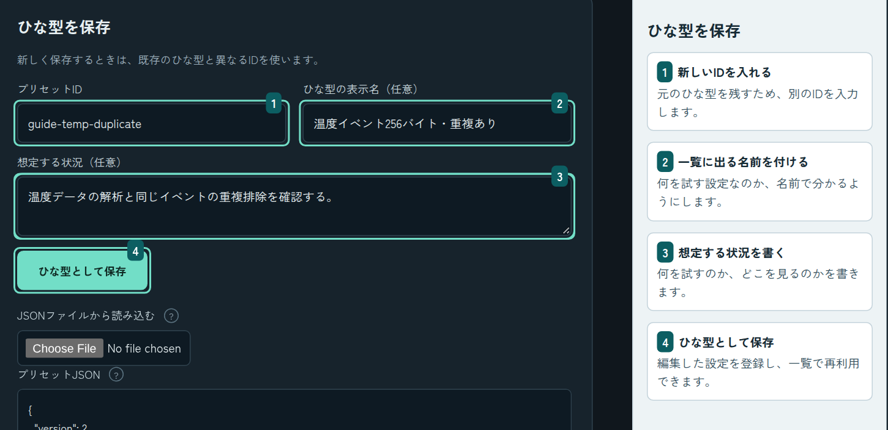

# ストリーム送信のひな型と詳細設定

ひな型（プリセット）は、生成するデータの項目・件数・書式や、再現したい異常をまとめた設定です。試したい状況に近いひな型を読み込み、見本を確認してから必要な設定を変えます。公開、書き込み、送信を始めるときは、画面の実行ボタンを使います。

## ひな型を選ぶ

**温度センサーイベント** を例にします。

受信側が温度センサーのイベントをトピックで振り分け、重複排除できるかを調べる場面です。

「イベントのひな型を選ぶ」で「温度センサーイベント」を押します。保存済みのひな型を使う場合は「保存済みプリセットから始める」を開きます。

イベントのひな型を選ぶと、その下に模擬する状況が表示されます。保存済みのひな型は「どんな状況のひな型か」と「生成内容・確認すること・実行前の条件」で用途を確認できます。

設備の状態と計測値なら「設備稼働イベント」、工程の進捗率なら「工程進捗イベント」、警告と重大警報なら「アラームイベント」を選びます。

全ひな型の用途は[プリセット一覧](../presets/README.md)を参照してください。

## 詳細設定を変更して見本を見る

基本設定で送信先にローカル記録を選び、件数を3にします。「詳細設定 → 本文形式 / 配送オプション」で「本文サイズの下限 (B)」を256、「重複率 (0〜1)」を1にします。

| 設定 | 変えられること |
| --- | --- |
| 本文サイズの下限 (B) | MQTTとローカル記録では必要に応じてJSON末尾に空白を足して指定したバイト数以上にします。 |
| 重複率 (0〜1) | 0は追加なし、1は全件を1回ずつ追加します。 |
| イベント定義 / イベント属性 | 項目名、型、生成ルールを選びます。本文の構造は「送信本文のJSON構造」で設定できます。 |

**見本での確認**　「送信内容の見本を見る」で temperature_c を含む本文が256バイト以上になり、重複予定が表示されることを確認します。重複率1は元の1件につき1回を追加する設定です。

## 自分のひな型を作って保存する

1. 上の例で編集した設定を残すには、「この設定を保存…」を押します。今の設定がJSON欄に入った保存画面が開きます。
2. 「プリセットID」に `guide-temp-duplicate` のような新しいIDを入力します。半角英数字、ハイフン、下線が使えます。同じIDで保存すると、そのひな型を更新します。
3. 必要に応じて表示名と想定する状況を入力し、「ひな型として保存」を押します。画面で編集した設定は、JSON欄を書き直さず保存できます。
4. 生成画面の「保存済みプリセットから始める」に戻り、新しく保存したIDを選んで「ひな型を読み込む」を押します。見本を出し、変更した条件が戻っていることを確認します。

たとえば設備ごとに受信先を振り分ける試験なら、「設備稼働イベント」を選びます。「詳細設定 → イベント定義 / イベント属性」で必要な項目を揃え、「送信内容の見本を見る」で設備IDや状態が本文に出ることを確認します。どの項目で振り分ける想定かを書いて保存します。

共有するひな型には「温度イベント256バイト・重複あり」のような表示名と、「温度データの解析と同じイベントの重複排除を確認する。」のような用途を書いておくと、次の人が選びやすくなります。接続先と認証は「接続先」で管理します。ひな型を別環境で使う場合は「JSONを書き出す」で持ち出し、利用先で接続設定を選び直します。

[操作ガイドに戻る](../README.md#操作ガイド)
