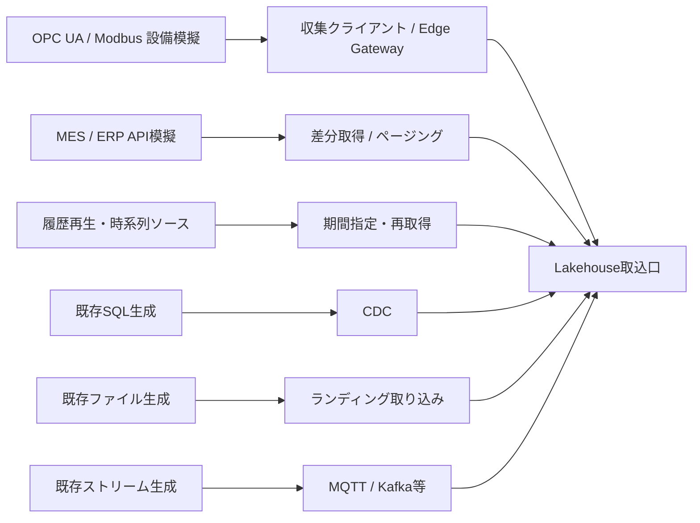

# 次に追加するデータソース

現在の3ツールは「SQLへ書く」「ファイルを置く」「イベントを送る」という出口を再現します。設備をクライアントが読み出す方式、業務APIを定期取得する方式、履歴を後から取得する方式も加えると、工場の取り込み構成を広く検証できます。以下は追加候補の設計で、現在の実装済み機能とは分けています。

| 優先度 | データソース | 想定するデータ・取り込み | 追加するシミュレーターと異常試験 |
| --- | --- | --- | --- |
| 1 | OPC UA / Modbus TCP | PLC、設備の状態・計測値・カウンター | 別リポジトリの設備サーバーを推奨。値・品質コード・レジスターを設定し、読み取り停止、固着、桁あふれ、型/倍率/バイト順の誤りを再現 |
| 2 | MES / ERP / WMSのREST・OData API | 指図、工程実績、在庫、入出庫、マスターを定期取得 | 別リポジトリの業務APIサーバーを推奨。ページング、更新差分、再取得、429/503、期限切れ認証、ページ欠落・重複を試験 |
| 3（半導体を重視する場合） | SECS/GEM / HSMS | 設備イベント、アラーム、状態変化、レシピ・ロット関連情報 | ステートフルな設備/ホスト模擬を別リポジトリで検討。切断復帰、タイムアウト、イベント収集条件、IDの不一致を試験。対象設備とSEMI規格に合わせて範囲を決める |
| 3 | ヒストリアン・時系列データ | 過去値の読み出し、バックフィル、期間集計 | 履歴サーバー/再生ツールを検討。履歴の欠落、遅延補正、保持期間、重複バックフィル、集計値と生値の違いを試験 |
| 4 | MTConnect | 工作機械の観測値・稼働情報 | Agent/Adapter構成の模擬。取り込みの再接続、観測値の更新停止、状態コードと時刻の扱いを確認 |
| 4 | 業務ファイルの追加形式 | Excel、XML、Parquet、Avro、検査レポートPDF | 既存ファイル生成ツールの拡張を優先。ヘッダー変更、日付表現、文字コード、分割、列型、破損ファイルを試験 |
| 4 | 検査装置・高頻度波形 | 振動、電流、音、スペクトル、連続画像・動画 | 低頻度の行データと大きなバイナリを分ける。時刻ずれ、サンプリング欠落、画像と結果の紐付け、単位の変化を検証 |
| 5 | ログ・監査・環境監視 | 設備ログ、アプリログ、Syslog、OS/ネットワーク状態 | ログ発生器や既存監視基盤から取り込む。MES/ERPの異常と設備・サーバー負荷を同じ時刻軸で照合 |
| 5 | 作業者・RFID・バーコード | 手入力実績、所在、通過、検品、材料投入 | API/イベントのプリセットとして先に再現可能。二重読み、読み飛ばし、順序逆転、別ロットへの誤登録を試験 |

OPC UAには値の監視に加え、アラームと履歴アクセスの仕様があります。設備側をサーバーとして用意し、収集クライアントの挙動を検証する対象に適しています。[OPC Foundationの仕様](https://reference.opcfoundation.org/specs/OPC-10000-1/full)

Modbusはclient/serverとgatewayの仕様を持つため、既存のメッセージ送信ツールとは異なる「読み出される設備」を試せます。[Modbus Organizationの仕様一覧](https://www.modbus.org/modbus-specifications)

半導体設備向けでは、SEMI E30はGEMの通信・制御モデル、E5はSECS-IIのメッセージ内容に対応します。[SEMI E30の公式説明](https://store-us.semi.org/products/e03000-semi-e30-specification-for-the-generic-model-for-communications-and-control-of-manufacturing-equipment-gem)

MTConnectは製造設備のデータを共通化する規格で、独自信号を変換するAdapterを含む構成を取ります。[MTConnect公式](https://mtconnect.org/)

## 推奨する実装順と役割

まず設備プロトコルのサーバーと、業務APIのサーバーを追加する案を推奨します。現在のHTTP送信はAPIクライアントなので、収集側がAPIをポーリングする試験には別のサーバーが必要です。データ形式が増えるだけなら、既存のファイル生成ツールへ追加し、リポジトリを際限なく分割しません。

これらを同じ検証シナリオで動かす場合は、equipment_id / work_order_id / lot_id / product_id等の業務キー、event_time、取り込み時刻、技術的なrecord_keyを分けて扱います。正常・異常の正解ラベルは業務データに混ぜず、別の試験結果として保持する設計を推奨します。そうすると、正常系の集計に加えて「設備異常→MES実績不整合→ERP在庫ずれ」を横断的に検証できます。
