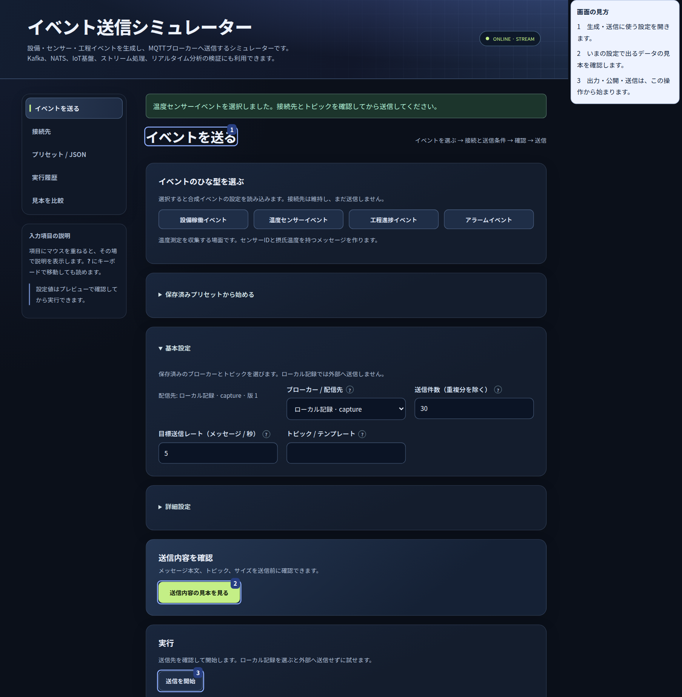

# ストリーム送信シミュレーター 操作マニュアル

生成した温度・設備状態・工程進捗・アラームのイベントで、受信側の振り分け、パース、重複排除を検証します。同梱MQTT、登録した配送先、またはローカル記録を選べます。

## 最初に試すこと

**温度イベント3件を送信先に出さずにローカルへ記録する**。元イベントは3件です。重複率を1にした試験では重複を含めて6件が記録されます。

[Docker Compose導入手順](vm-compose.md)で準備し、VMで `http://127.0.0.1:3562/` を開きます。

イベントは設備の状態や温度など、ある時点の出来事を表すデータです。最初は「ローカル記録」を使います。MQTTを試す段階では、ブローカー（受け渡し役）と同じトピック（振り分け先の名前）を送信側と受信側に設定します。

1. 「イベントを送る」で「温度センサーイベント」を選びます。選ぶと本文の例が入ります。
2. 送信先に「ローカル記録」、件数に `3` を指定します。「詳細設定」の本文と配送の設定で、本文サイズの下限を `256`、重複率を `1` にします。
3. 「送信内容の見本を見る」を押し、`temperature_c`、本文サイズと重複予定を確認します。
4. 「送信を開始」を押して「実行履歴」を開きます。完了、元件数、記録した重複を確認します。MQTTへ切り替える場合は対象トピックを先に購読してから送ります。

## よくある質問

### ブローカーが起動したら送信も始まりますか？

アプリの画面で送信を開始するとイベントが出ます。ブローカーは先に待ち受けていて構いません。

### 送信成功なのに受信側で見つかりません

トピック、先に購読を始めたか、受信側のエラーを確認します。ブローカーの受付と、受信アプリが処理を終えたことは別の結果です。

### outboxはどこで見ますか？

「実行履歴」に未配送を確認する欄があります。再送前に元の接続先を照合します。

## 停止と再起動

ジョブは設定件数で終了します。ブローカーにメッセージが届いても、後段で処理が完了したかは受信側で照合します。

## 想定した結果が出ないとき

メッセージが見つからなければ、先に購読を開始したか、トピック、ポート、接続先の認証・TLSが一致するかを確認します。

## 送信先の名前と本文を組み立てる

| 設定 | 役割 |
| --- | --- |
| topic_template | MQTTなどで受け取る宛先名を合成します。同じ名前で購読します。 |
| payload_template | 生成した行から、送るJSON本文の構造を組み立てます。 |
| envelope | メタデータ付きの本文にします。有効時は本文がJSONオブジェクトになり、既定のメタデータキーは _source です。 |

「実行履歴」→「ローカル記録の本文を見る」で、送信先をローカルにしたイベントの本文を開けます。表示中のページをJSON Linesとしてダウンロードできます。同じIDでも外部へ配送した記録はこの一覧の対象から外れます。

## 次に読む

- [ひな型を選ぶ・作る](preset-guide.md)
- [設定リファレンス](settings-reference.md)
- [JSONの書き方](template-guide.md)
- [APIの使い方](api-guide.md)
- [用語集](glossary.md)
